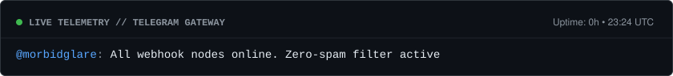

  
  
  

    <a href="https://t.me/morbidglare"><kbd>&#160;tg: @morbidglare&#160;</kbd></a>
    &#160;•&#160;
    <kbd>&#160;18 y.o.&#160;</kbd>
    &#160;•&#160;
    <kbd>&#160;open for freelance &amp; internships&#160;</kbd>
  

  

  

 

<table width="100%">
  <tr>
    <td width="52%" valign="top">
      <h3><code>/etc/nexedov/profile.json</code></h3>
      <pre lang="json"><code>{
  "dev": "nexedov",
  "age": 18,
  "stack": [
    "Python 3",
    "Aiogram 3",
    "JSON & REST API"
  ],
  "focus": [
    "Async Telegram bots",
    "API caching",
    "Clean inline UX"
  ]
}</code></pre>
    </td>
    <td width="48%" valign="top">
      <h3><code>/usr/bin/tech_arsenal</code></h3>
      

        <kbd>Python 3</kbd> <kbd>Asyncio</kbd> <kbd>Aiogram 3</kbd> <kbd>Aiohttp</kbd> 
      

      

        <kbd>JSON</kbd> <kbd>Git</kbd> <kbd>REST API</kbd>
      

      

      <h3><code>/var/log/shipped_features</code></h3>
      <ul>
        <li><b>Single-Message UI:</b> building bots that navigate through a single inline message without spamming the chat history.</li>
        <li><b>Zero-Disk Media:</b> serving photos and files directly via Telegram <code>file_id</code> to save server storage.</li>
        <li><b>API Caching:</b> caching external API responses in RAM to prevent rate limits and ensure instant replies.</li>
        <li><b>Load Control:</b> writing custom middlewares to protect bots from user flood and spam clicks.</li>
      </ul>
    </td>
  </tr>
</table>

 

<h3 align="center"><code>[ ARCHITECTURE // PIPELINE ]</code></h3>

  

 

<h3 align="center"><code>[ CONTRIBUTIONS ]</code></h3>

  <picture>
    <source media="(prefers-color-scheme: dark)" srcset="./assets/snake-dark.svg" />
    <source media="(prefers-color-scheme: light)" srcset="./assets/snake-light.svg" />
    
  </picture>

