  <!-- ТВОЙ СОБСТВЕННЫЙ АНИМИРОВАННЫЙ SVG-БАННЕР (РАБОТАЕТ ВСЕГДА НА 100%) -->
  

    

  <!-- ИСПРАВЛЕННАЯ ПЕЧАТАЮЩАЯСЯ СТРОКА (БЕЗ ЗАПРЕЩЕННЫХ СИМВОЛОВ) -->
  

   

  <!-- СТРОГАЯ ЧЕРНО-БЕЛАЯ НАВИГАЦИЯ (РАБОТАЕТ ДАЖЕ БЕЗ ВНЕШНИХ КАРТИНОК) -->
  

    <a href="https://t.me/morbidglare"><kbd><b>&#160;&#160;✈️ TELEGRAM: @morbidglare&#160;&#160;</b></kbd></a>
    &#160;&#160;•&#160;&#160;
    <kbd>&#160;&#160;⚡ 17 YEARS OLD&#160;&#160;</kbd>
    &#160;&#160;•&#160;&#160;
    <kbd>&#160;&#160;🎯 OPEN FOR FREELANCE & INTERNSHIP&#160;&#160;</kbd>
  

<!-- ДВУХКОЛОНОЧНЫЙ ДАШБОРД -->
<table width="100%">
  <tr>
    <td width="55%" valign="top">
      <h3><code>⚡ /etc/nexedov/profile.json</code></h3>
      <pre lang="json"><code>{
  "developer": "nexedov",
  "age": 17,
  "location": "Russia",
  "focus": "Async Python & Telegram Bot Architecture",
  "stack": [
    "Python 3.11+ (asyncio, aiohttp)",
    "Telegram Bot API (aiogram 3)",
    "REST APIs & JSON Data Modeling",
    "Web Basics (HTML5, JavaScript)",
    "Git & GitHub Actions"
  ],
  "engineering_features": [
    "Single-Message Bot UI (Zero Spam)",
    "Anti-Flood & Rate-Limiting Middlewares",
    "Zero-Disk Media Streaming (via file_id)",
    "In-Memory Caching (TTL 10 min)"
  ],
  "telegram": "t.me/morbidglare"
}</code></pre>
    </td>
    <td width="45%" valign="top">
      <h3><code>🛠 /usr/bin/tech_arsenal</code></h3>
      
<b>Языки и Веб-технологии:</b>

      

        <kbd>&#160;🐍 <b>Python 3</b>&#160;</kbd>&#160;
        <kbd>&#160;📜 <b>JavaScript</b>&#160;</kbd>&#160;
        <kbd>&#160;🌐 <b>HTML5</b>&#160;</kbd>
      

      
<b>Инструменты, API и Архитектура:</b>

      

        <kbd>&#160;🤖 <b>Aiogram 3</b>&#160;</kbd>&#160;
        <kbd>&#160;📡 <b>Telegram Bot API</b>&#160;</kbd>&#160;
        <kbd>&#160;🔌 <b>REST API</b>&#160;</kbd>
      

      

        <kbd>&#160;🗄 <b>JSON Storage</b>&#160;</kbd>&#160;
        <kbd>&#160;🌿 <b>Git</b>&#160;</kbd>&#160;
        <kbd>&#160;🐙 <b>GitHub CI/CD</b>&#160;</kbd>
      

      

      
<b>Инженерный почерк:</b>

      <ul>
        <li>⚡ <b>Асинхронное ядро:</b> Мгновенные неблокирующие запросы к внешним сервисам.</li>
        <li>🛡 <b>Защита от DDoS и флуда:</b> Собственные <code>Middleware</code> на ограничение частоты кликов.</li>
        <li>💎 <b>Чистый UX:</b> Плавная перерисовка одного активного сообщения вместо простыней спама.</li>
      </ul>
    </td>
  </tr>
</table>

 

<!-- БЛОК СПЕЦИАЛИЗАЦИИ -->
<h2 align="center"><code>[ АРХИТЕКТУРА И ТЕХНОЛОГИЧЕСКИЙ ФОКУС ]</code></h2>

<table width="100%">
  <tr>
    <td width="33%" valign="top">
      <h3 align="center">🤖 Telegram Bot Architecture</h3>
      
Пишу продвинутых асинхронных ботов на <b>aiogram 3</b>. Строю полноценные приложения внутри Telegram: с разделением прав (пользователь / модератор), пуш-уведомлениями, фильтрацией по подгруппам и динамическими инлайн-экранами.

    </td>
    <td width="33%" valign="top">
      <h3 align="center">🌐 REST API & Кэширование</h3>
      
Интегрирую внешние сервисы (например, <b>OpenWeatherMap API</b>), парсю геопозицию со смартфонов и запросы на RU/EN. Внедряю <b>In-Memory кэширование</b> на 10 минут, чтобы не выжирать лимиты API и отдавать ответ мгновенно.

    </td>
    <td width="33%" valign="top">
      <h3 align="center">⚙️ Оптимизация & Защита</h3>
      
Реализую <b>Zero-Disk стриминг медиа</b> через внутренние <code>file_id</code> серверов Telegram (фото, видео и доки хранятся в облаке ТГ без нагрузки на диск). Защищаю ботов от спам-навесов через кастомные <b>Throttling Middleware</b>.

    </td>
  </tr>
</table>

 

<!-- ФЛАГМАНСКИЕ ПРОЕКТЫ (НЕЗАВИСИМЫЕ КАРТОЧКИ, КОТОРЫЕ НЕ ПАДАЮТ) -->
<h2 align="center"><code>[ ФЛАГМАНСКИЕ ПРОЕКТЫ // SHOWCASE ]</code></h2>

<table width="100%">
  <tr>
    <!-- РЕПОЗИТОРИЙ 1 -->
    <td width="50%" valign="top">
      <h3>📚 <a href="https://github.com/nexedov/college-dz-bot">nexedov / college-dz-bot</a></h3>
      

        <kbd>Python</kbd> <kbd>Telegram Bot API</kbd> <kbd>JSON Storage</kbd> <kbd>Zero-Disk Media</kbd>
      

      
<b>Телеграм-бот с домашкой и расписанием для студенческой группы.</b>

      
Данные хранятся локально в структурированном JSON, а тяжелые медиафайлы подгружаются напрямую через <code>file_id</code> без сохранения на диск сервера.

      <ul>
        <li>📅 <b>Расписание и ДЗ:</b> Быстрый доступ к парам и заданиям по каждому предмету.</li>
        <li>👥 <b>Фильтр подгрупп:</b> Умное разделение расписания для 1 и 2 подгруппы.</li>
        <li>✅ <b>Личный трекер:</b> Персональные отметки о выполнении заданий для каждого студента.</li>
        <li>📎 <b>Медиа-вложения:</b> Прикрепление фото, видео и документов к предметам.</li>
        <li>🔔 <b>Админ-панель:</b> Закрытая панель модератора + авто-уведомления при обновлении ДЗ.</li>
      </ul>
      

        <a href="https://github.com/nexedov/college-dz-bot"><kbd><b>&#160;&#160;📂 ОТКРЫТЬ КОД ПРОЕКТА ➔&#160;&#160;</b></kbd></a>
      

    </td>
    <!-- РЕПОЗИТОРИЙ 2 -->
    <td width="50%" valign="top">
      <h3>🌪 <a href="https://github.com/nexedov/weather-telegram-bot">nexedov / weather-telegram-bot</a></h3>
      

        <kbd>Python</kbd> <kbd>Aiogram 3</kbd> <kbd>OpenWeatherMap API</kbd> <kbd>Middleware</kbd> <kbd>RAM Cache</kbd>
      

      
<b>Асинхронный погодный бот с человеческими советами по выбору одежды.</b>

      
Не просто выдает сухие цифры, а анализирует температуру, ветер и осадки, подсказывая, что надеть перед выходом, чтобы не продуло и не попасть под дождь.

      <ul>
        <li>🌍 <b>Мульти-поиск и Гео:</b> Ищет города на русском/английском + определяет локацию по кнопке со смартфона.</li>
        <li>🕒 <b>Детальный прогноз:</b> Текущая сводка и почасовой расклад на ближайшие 24 часа.</li>
        <li>🧥 <b>Умный гардероб:</b> Живые рекомендации по экипировке под конкретную погоду.</li>
        <li>🖥 <b>Single-Message UI (Без спама):</b> Весь интерфейс плавно перерисовывается внутри одного активного сообщения на инлайн-кнопках.</li>
        <li>🛡 <b>Анти-флуд и Кэш:</b> Защищен от DDoS-кликов через <code>Middleware</code> + кэширует погоду в память на 10 минут для экономии лимитов API.</li>
      </ul>
      

        <a href="https://github.com/nexedov/weather-telegram-bot"><kbd><b>&#160;&#160;📂 ОТКРЫТЬ КОД ПРОЕКТА ➔&#160;&#160;</b></kbd></a>
      

    </td>
  </tr>
</table>

 

<!-- МОНОХРОМНАЯ ЗМЕЙКА АКТИВНОСТИ -->
<h2 align="center"><code>[ ТЕЛЕМЕТРИЯ КОММИТОВ // CONTRIBUTION SNAKE ]</code></h2>

  <picture>
    <source media="(prefers-color-scheme: dark)" srcset="./assets/snake-dark.svg" />
    <source media="(prefers-color-scheme: light)" srcset="./assets/snake-light.svg" />
    
  </picture>

