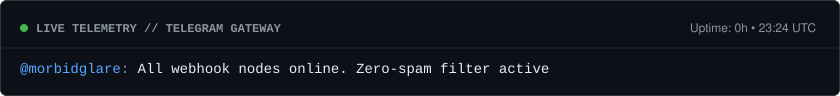

  

    

  

  

    <a href="https://t.me/morbidglare"><kbd>&#160;tg: @morbidglare&#160;</kbd></a>
    &#160;•&#160;
    <kbd>&#160;17 y.o.&#160;</kbd>
    &#160;•&#160;
    <kbd>&#160;open for freelance &amp; internships&#160;</kbd>
  

  

  

 

<table width="100%">
  <tr>
    <td width="52%" valign="top">
      <h3><code>/etc/nexedov/profile.json</code></h3>
      <pre lang="json"><code>{
  "dev": "nexedov",
  "age": 17,
  "stack": [
    "Python 3.11+ (asyncio, aiohttp)",
    "Aiogram 3 / Telegram Bot API",
    "REST APIs & JSON Storage",
    "HTML5, CSS3, JS",
    "Git & GitHub Actions"
  ],
  "patterns": [
    "Single-message inline UI",
    "Custom throttling middlewares",
    "Zero-disk media via file_id",
    "In-memory TTL caching"
  ]
}</code></pre>
    </td>
    <td width="48%" valign="top">
      <h3><code>/usr/bin/tech_arsenal</code></h3>
      

        <kbd>Python 3</kbd> <kbd>Asyncio</kbd> <kbd>Aiogram 3</kbd> <kbd>Aiohttp</kbd> <kbd>REST API</kbd>
      

      

        <kbd>JSON</kbd> <kbd>HTML5 / JS</kbd> <kbd>Git</kbd> <kbd>GitHub Actions</kbd> <kbd>Linux</kbd>
      

      

      <h3><code>/var/log/shipped_features</code></h3>
      <ul>
        <li><b>Single-Message UI:</b> навигация и смена экранов через редактирование одного сообщения без мусора в чате.</li>
        <li><b>Zero-Disk Media:</b> раздача фото, видео и документов напрямую из облака Telegram по <code>file_id</code>.</li>
        <li><b>API &amp; Кэш:</b> асинхронные запросы к внешним сервисам + хранение ответов в RAM (TTL 10 мин).</li>
        <li><b>Контроль нагрузки:</b> кастомные <code>Middleware</code> от спама кликами и разделение ролей (юзер / админ).</li>
      </ul>
    </td>
  </tr>
</table>

 

<h3 align="center"><code>[ ARCHITECTURE // PIPELINE ]</code></h3>

  

 

<h3 align="center"><code>[ PROJECTS // SHOWCASE ]</code></h3>

<table width="100%">
  <tr>
    <td width="50%" valign="top">
      <h3><a href="https://github.com/nexedov/college-dz-bot">nexedov / college-dz-bot</a></h3>
      

        <code>aiogram 3</code> <code>json-db</code> <code>file-id-stream</code> <code>admin-panel</code>
      

      
Бот с расписанием, домашкой и учебными материалами для студенческой группы.

      <ul>
        <li>Фильтрация расписания по 1 и 2 подгруппе + индивидуальные чек-листы готовых ДЗ.</li>
        <li>Прикрепление тяжелых медиа и файлов к предметам через <code>file_id</code> без загрузки на диск сервера.</li>
        <li>Закрытая админка для старост с автоматической рассылкой пушей при обновлении заданий.</li>
      </ul>
      

        <a href="https://github.com/nexedov/college-dz-bot"><kbd>&#160;source code ➔&#160;</kbd></a>
      

    </td>
    <td width="50%" valign="top">
      <h3><a href="https://github.com/nexedov/weather-telegram-bot">nexedov / weather-telegram-bot</a></h3>
      

        <code>aiogram 3</code> <code>aiohttp</code> <code>openweather-api</code> <code>ttl-cache</code>
      

      
Погодный бот с почасовым прогнозом и подбором одежды под температуру, ветер и осадки.

      <ul>
        <li>Поиск городов на RU/EN и парсинг геолокации со смартфона в один тап.</li>
        <li>Весь интерфейс работает внутри одного сообщения на инлайн-клавиатурах.</li>
        <li>In-Memory кэширование ответов API на 10 минут и защита от флуда через <code>Middleware</code>.</li>
      </ul>
      

        <a href="https://github.com/nexedov/weather-telegram-bot"><kbd>&#160;source code ➔&#160;</kbd></a>
      

    </td>
  </tr>
</table>

 

<h3 align="center"><code>[ CONTRIBUTIONS ]</code></h3>

  <picture>
    <source media="(prefers-color-scheme: dark)" srcset="./assets/snake-dark.svg" />
    <source media="(prefers-color-scheme: light)" srcset="./assets/snake-light.svg" />
    
  </picture>

****
